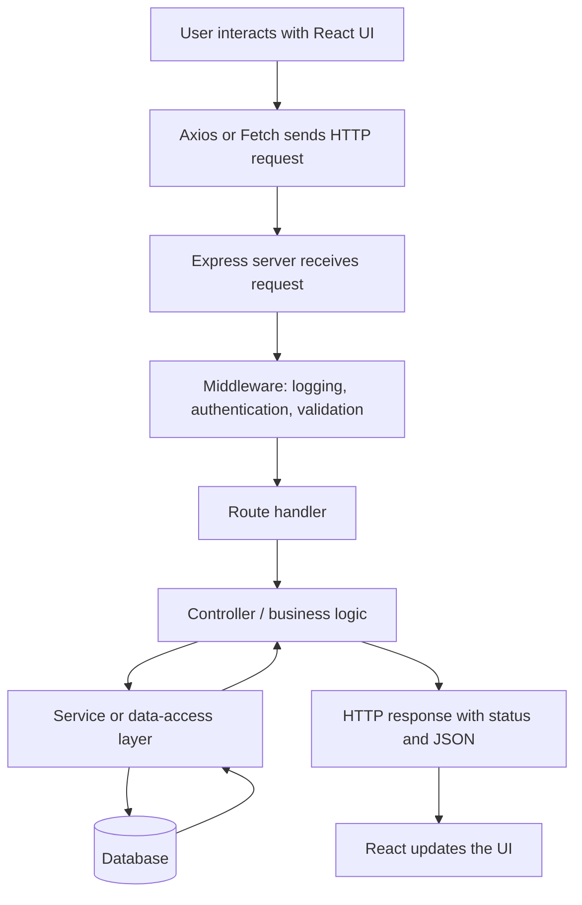
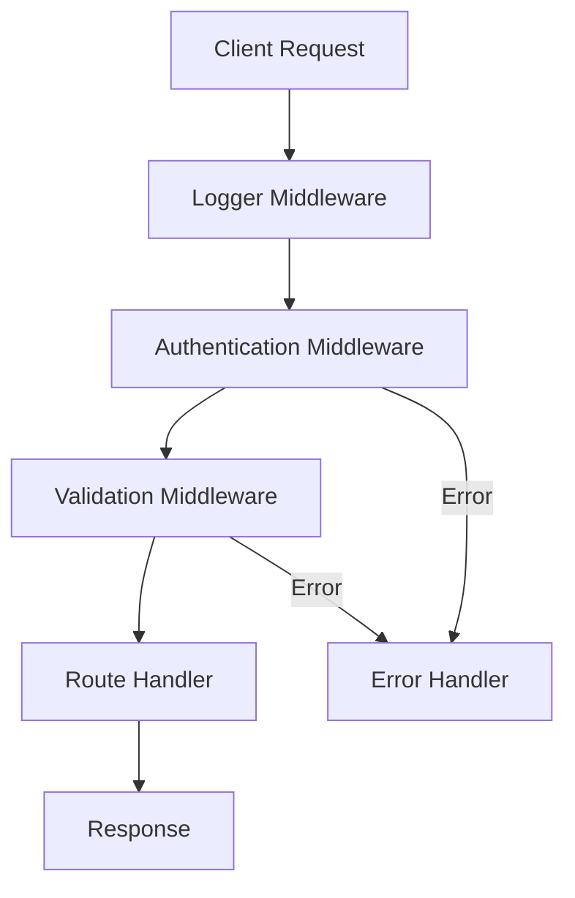
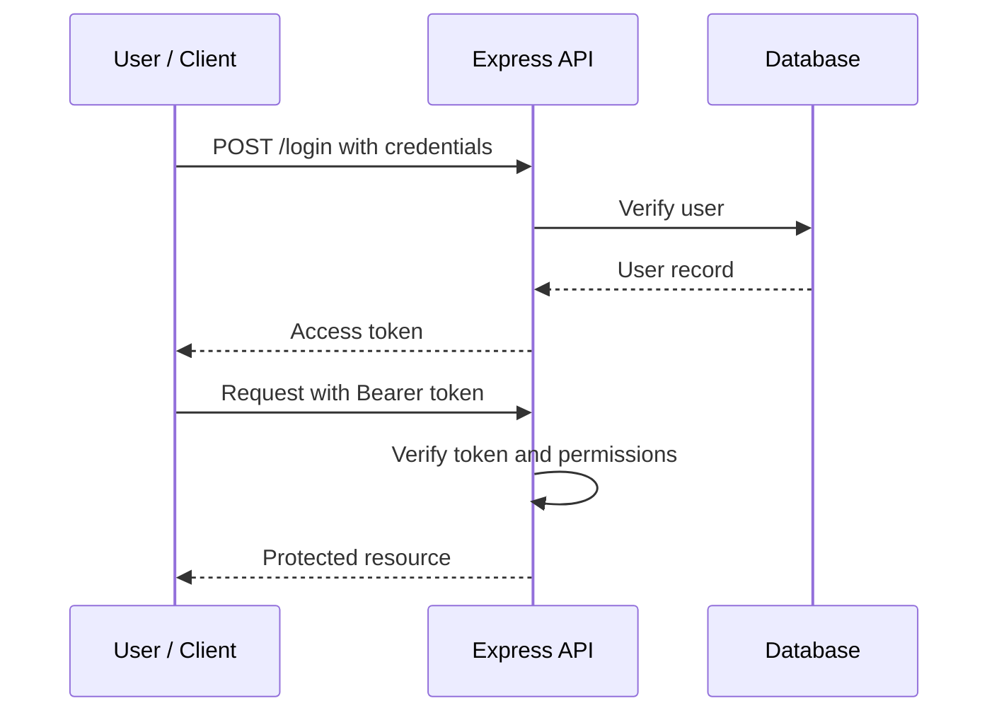
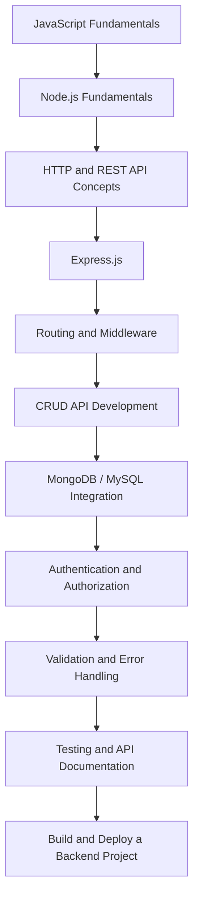
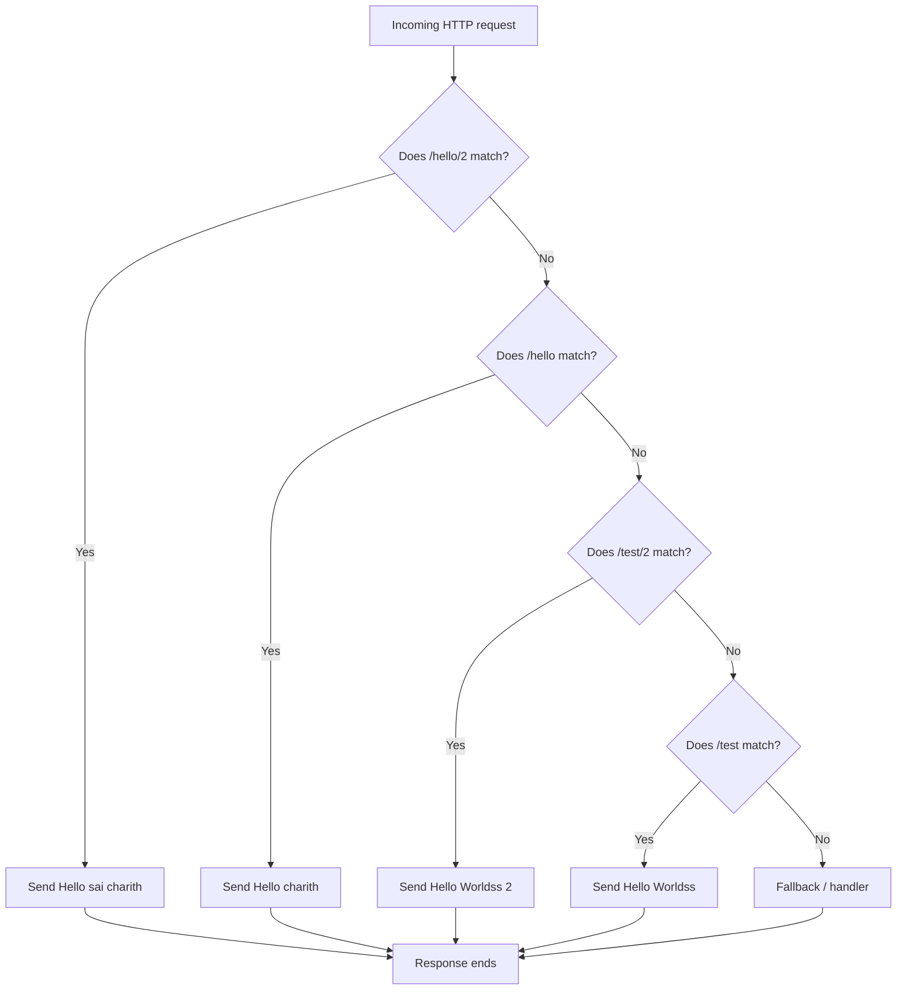
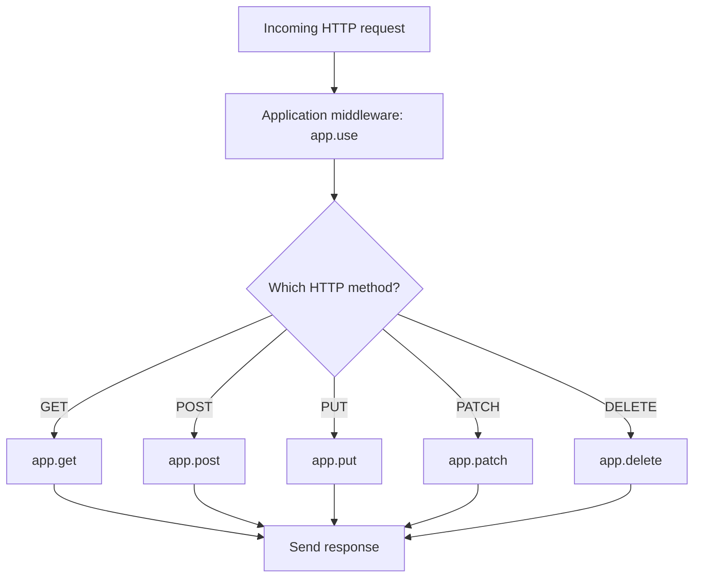

<!-- START doctoc generated TOC please keep comment here to allow auto update -->
<!-- DON'T EDIT THIS SECTION, INSTEAD RE-RUN doctoc TO UPDATE -->
**Table of Contents**  *generated with [DocToc](https://github.com/thlorenz/doctoc)*

- [My-Learnings](#my-learnings)
  - [This is the repo where you can see everything irrespective of the subject. You can see about news, Cricket, daily updates, technologies and etc..](#this-is-the-repo-where-you-can-see-everything-irrespective-of-the-subject-you-can-see-about-news-cricket-daily-updates-technologies-and-etc)
  - [Table of Contents](#table-of-contents)
  - [1. Introduction](#1-introduction)
  - [2. What Is an API?](#2-what-is-an-api)
  - [3. What Is REST?](#3-what-is-rest)
    - [3.1 What is a resource?](#31-what-is-a-resource)
    - [3.2 Six REST architectural constraints](#32-six-rest-architectural-constraints)
  - [4. REST Architecture and Request Lifecycle](#4-rest-architecture-and-request-lifecycle)
    - [Example: Fetching users](#example-fetching-users)
  - [5. HTTP Methods](#5-http-methods)
    - [GET — Retrieve data](#get--retrieve-data)
    - [POST — Create data](#post--create-data)
    - [PUT — Replace a resource](#put--replace-a-resource)
    - [PATCH — Partially update a resource](#patch--partially-update-a-resource)
    - [DELETE — Remove a resource](#delete--remove-a-resource)
    - [PUT vs PATCH](#put-vs-patch)
  - [6. HTTP Status Codes](#6-http-status-codes)
  - [7. Request and Response Structure](#7-request-and-response-structure)
    - [7.1 Path parameters vs query parameters vs request body](#71-path-parameters-vs-query-parameters-vs-request-body)
  - [8. REST API Design Principles](#8-rest-api-design-principles)
  - [9. What Is Node.js?](#9-what-is-nodejs)
  - [10. What Is Express.js?](#10-what-is-expressjs)
    - [Why use Express.js?](#why-use-expressjs)
  - [11. Creating an Express.js Server](#11-creating-an-expressjs-server)
    - [Step 1: Create a project](#step-1-create-a-project)
    - [Step 2: Install Express](#step-2-install-express)
    - [Step 3: Create `server.js`](#step-3-create-serverjs)
    - [Step 4: Start the server](#step-4-start-the-server)
    - [What does each line do?](#what-does-each-line-do)
  - [12. Routing and Route Parameters](#12-routing-and-route-parameters)
    - [Route parameters](#route-parameters)
  - [13. Request and Response Objects](#13-request-and-response-objects)
    - [Request object (`req`)](#request-object-req)
    - [Response object (`res`)](#response-object-res)
  - [14. Middleware](#14-middleware)
    - [Middleware flow](#middleware-flow)
    - [Example: Custom middleware](#example-custom-middleware)
    - [Types of middleware](#types-of-middleware)
    - [Built-in middleware](#built-in-middleware)
    - [Third-party middleware](#third-party-middleware)
  - [15. Express Router](#15-express-router)
  - [16. Controllers and Project Structure](#16-controllers-and-project-structure)
  - [17. CRUD REST API Example](#17-crud-rest-api-example)
    - [Complete `server.js`](#complete-serverjs)
    - [Test with Postman](#test-with-postman)
  - [18. Calling APIs from React](#18-calling-apis-from-react)
    - [Axios vs Fetch](#axios-vs-fetch)
  - [19. Error Handling](#19-error-handling)
    - [Basic route error](#basic-route-error)
    - [Centralized error-handling middleware](#centralized-error-handling-middleware)
  - [20. Authentication and Authorization](#20-authentication-and-authorization)
    - [Authentication](#authentication)
    - [Authorization](#authorization)
    - [JWT authentication flow](#jwt-authentication-flow)
  - [21. CORS, Validation, and Security](#21-cors-validation-and-security)
    - [CORS](#cors)
    - [Input validation](#input-validation)
    - [Security checklist](#security-checklist)
  - [22. Pagination, Filtering, Sorting, and Versioning](#22-pagination-filtering-sorting-and-versioning)
    - [Pagination](#pagination)
    - [Filtering](#filtering)
    - [Sorting](#sorting)
    - [API versioning](#api-versioning)
  - [23. REST vs SOAP vs GraphQL](#23-rest-vs-soap-vs-graphql)
  - [24. Node.js vs Express.js vs React.js](#24-nodejs-vs-expressjs-vs-reactjs)
  - [25. Testing REST APIs](#25-testing-rest-apis)
    - [Postman testing checklist](#postman-testing-checklist)
  - [26. Common Interview Questions](#26-common-interview-questions)
    - [REST API questions](#rest-api-questions)
    - [Express.js questions](#expressjs-questions)
    - [More topics to prepare](#more-topics-to-prepare)
  - [27. Quick Revision](#27-quick-revision)
  - [Learning Roadmap](#learning-roadmap)
    - [Suggested hands-on projects](#suggested-hands-on-projects)
    - [Useful official documentation](#useful-official-documentation)
    - [Understanding `^` and `~` in Package Versions](#understanding-%5E-and--in-package-versions)
  - [1. Semantic Versioning (SemVer)](#1-semantic-versioning-semver)
  - [2. Caret (`^`) — Compatible Minor and Patch Updates](#2-caret-%5E--compatible-minor-and-patch-updates)
  - [3. Tilde (`~`) — Patch Updates](#3-tilde---patch-updates)
  - [4. Difference Between `^` and `~`](#4-difference-between-%5E-and-)
  - [5. Exact Version — No Symbol](#5-exact-version--no-symbol)
  - [6. Practical `package.json` Example](#6-practical-packagejson-example)
  - [7. Useful npm Commands](#7-useful-npm-commands)
    - [What does `package-lock.json` do?](#what-does-package-lockjson-do)
  - [8. Important Note About `0.x` Versions](#8-important-note-about-0x-versions)
  - [9. Interview Question](#9-interview-question)
  - [Key Takeaways](#key-takeaways)
  - [28. Why Routing Order Is Important in Express.js](#28-why-routing-order-is-important-in-expressjs)
    - [Your example](#your-example)
    - [What happens when you visit each URL?](#what-happens-when-you-visit-each-url)
    - [Why should the more specific path come first?](#why-should-the-more-specific-path-come-first)
    - [Visualizing the order](#visualizing-the-order)
    - [Correct routing order](#correct-routing-order)
    - [`app.use()` vs `app.get()` — important distinction](#appuse-vs-appget--important-distinction)
    - [What does `next()` do?](#what-does-next-do)
    - [Interview answer](#interview-answer)
  - [**Key takeaway:** In Express.js, registration order matters. Put specific handlers first, general handlers later, and catch-all handlers last.](#key-takeaway-in-expressjs-registration-order-matters-put-specific-handlers-first-general-handlers-later-and-catch-all-handlers-last)
  - [This README covers REST APIs, Express.js, routing, middleware, CRUD operations, and backend development.](#this-readme-covers-rest-apis-expressjs-routing-middleware-crud-operations-and-backend-development)
  - [29. Difference Between `app.use()`, `app.get()`, `app.post()`, and Other Express Methods](#29-difference-between-appuse-appget-apppost-and-other-express-methods)
    - [29.1 Quick comparison](#291-quick-comparison)
    - [29.2 `app.use()` — register middleware](#292-appuse--register-middleware)
    - [29.3 `app.get()` — handle GET requests](#293-appget--handle-get-requests)
    - [29.4 `app.post()` — handle POST requests](#294-apppost--handle-post-requests)
    - [29.5 `app.put()` — replace a resource](#295-appput--replace-a-resource)
    - [29.6 `app.patch()` — partially modify a resource](#296-apppatch--partially-modify-a-resource)
    - [29.7 `app.delete()` — delete a resource](#297-appdelete--delete-a-resource)
    - [29.8 `app.all()` — handle all HTTP methods for a route](#298-appall--handle-all-http-methods-for-a-route)
    - [29.9 `app.listen()` — start the server](#299-applisten--start-the-server)
    - [29.10 Visual request flow](#2910-visual-request-flow)
    - [29.11 `app.use()` vs `app.get()` — practical difference](#2911-appuse-vs-appget--practical-difference)
    - [29.12 Important: route matching and registration order](#2912-important-route-matching-and-registration-order)
    - [29.13 Complete example](#2913-complete-example)
    - [29.14 Interview question](#2914-interview-question)

<!-- END doctoc generated TOC please keep comment here to allow auto update -->
---

## 1. Introduction

Modern applications are usually divided into a frontend, backend, and database.

- **Frontend:** Displays the user interface. Example: React.js.
- **Backend:** Implements business logic and exposes APIs. Example: Node.js with Express.js.
- **Database:** Stores application data. Example: MongoDB, MySQL, or PostgreSQL.
- **API:** Defines how different parts of a system communicate.

A REST API is a common way for a frontend and backend to exchange data over HTTP.

## 2. What Is an API?

API stands for **Application Programming Interface**. It is a defined way for one software component to communicate with another.

For example, when a user opens a profile page:

1. The frontend sends a request for the user's profile.
2. The backend receives and processes the request.
3. The backend may retrieve the user's information from a database.
4. The backend returns a response, often in JSON.
5. The frontend displays the profile.

An API is a contract between the client and the server: it defines the available operations, inputs, and outputs.

## 3. What Is REST?

**REST (Representational State Transfer)** is an architectural style for designing networked applications. A RESTful API commonly exposes resources through URLs and uses HTTP methods to operate on those resources.

Example resource: users.

```http
GET    /api/users
GET    /api/users/101
POST   /api/users
PUT    /api/users/101
PATCH  /api/users/101
DELETE /api/users/101
```

REST is an architectural style, not a programming language, library, or protocol.

### 3.1 What is a resource?

A resource is an entity that an API exposes, such as:

- Users
- Products
- Orders
- Payer groups
- Payments

A resource is usually represented by a noun in the URL, such as `/api/users`.

### 3.2 Six REST architectural constraints

A system is considered RESTful when it follows these architectural constraints:

1. **Client–Server:** The client interface and server data responsibilities are separated.
2. **Stateless:** Each request contains the information needed to process it. The server does not rely on stored client session context between requests.
3. **Cacheable:** Responses should indicate whether they can be cached.
4. **Uniform Interface:** Resources are identified and manipulated through a consistent interface.
5. **Layered System:** A client may communicate through intermediaries such as gateways or proxies without needing to know the system's internal layers.
6. **Code on Demand (optional):** A server may send executable code to a client. This constraint is optional.

## 4. REST Architecture and Request Lifecycle



### Example: Fetching users

```http
GET /api/users
```

Example JSON response:

```json
{
  "success": true,
  "data": [
    {
      "id": 1,
      "name": "Charith",
      "email": "charith@example.com"
    }
  ]
}
```

The exact response structure is an API design choice. Keep it consistent across endpoints.

## 5. HTTP Methods

HTTP methods describe the operation a client wants to perform.

| Method | Purpose | Example |
|---|---|---|
| GET | Read a resource | `GET /api/users` |
| POST | Create a resource or trigger an operation | `POST /api/users` |
| PUT | Replace a resource representation | `PUT /api/users/101` |
| PATCH | Partially modify a resource | `PATCH /api/users/101` |
| DELETE | Delete a resource | `DELETE /api/users/101` |

### GET — Retrieve data

```http
GET /api/users
```

Returns a collection of users.

### POST — Create data

```http
POST /api/users
Content-Type: application/json
```

```json
{
  "name": "Charith",
  "email": "charith@example.com"
}
```

### PUT — Replace a resource

```http
PUT /api/users/101
Content-Type: application/json
```

```json
{
  "name": "Charith P",
  "email": "charith.p@example.com"
}
```

PUT generally represents replacement of the target resource. The API should document how omitted fields are handled.

### PATCH — Partially update a resource

```http
PATCH /api/users/101
Content-Type: application/json
```

```json
{
  "name": "Charith P"
}
```

Only the supplied field is being changed, according to the API's patch semantics.

### DELETE — Remove a resource

```http
DELETE /api/users/101
```

### PUT vs PATCH

| PUT | PATCH |
|---|---|
| Usually replaces the resource representation | Applies a partial modification |
| Client generally sends the full representation | Client sends the changes |
| Defined as idempotent | Idempotency depends on the patch operation |

**Idempotency:** An operation is idempotent when repeating the same request has the same intended effect as performing it once. GET, PUT, and DELETE are defined as idempotent methods. POST is not generally idempotent. PATCH may or may not be idempotent depending on its implementation.

## 6. HTTP Status Codes

Status codes tell the client the outcome of a request.

| Code | Name | Meaning |
|---|---|---|
| 200 | OK | Request succeeded |
| 201 | Created | A resource was created |
| 202 | Accepted | Request accepted for processing |
| 204 | No Content | Request succeeded with no response body |
| 301 | Moved Permanently | Resource has a permanent new URL |
| 400 | Bad Request | Request is invalid |
| 401 | Unauthorized | Authentication is missing or invalid |
| 403 | Forbidden | Client is not allowed to perform the action |
| 404 | Not Found | Resource does not exist |
| 405 | Method Not Allowed | HTTP method is not supported for the resource |
| 409 | Conflict | Request conflicts with the current resource state |
| 415 | Unsupported Media Type | Request content type is unsupported |
| 422 | Unprocessable Content | Request syntax is valid but its instructions cannot be processed |
| 429 | Too Many Requests | Rate limit exceeded |
| 500 | Internal Server Error | Unexpected server error |
| 502 | Bad Gateway | Invalid response from an upstream server |
| 503 | Service Unavailable | Server temporarily cannot handle the request |

Important distinction:

- **401:** Authentication problem — the client has not provided valid credentials.
- **403:** Authorization problem — the client is known but lacks permission.

## 7. Request and Response Structure

An HTTP request can contain:

- Method
- URL/path
- Headers
- Query parameters
- Path parameters
- Body (when applicable)

Example:

```http
POST /api/users?source=website HTTP/1.1
Host: localhost:5000
Content-Type: application/json
Authorization: Bearer <access-token>

{
  "name": "Charith",
  "email": "charith@example.com"
}
```

An HTTP response contains a status code, headers, and sometimes a body.

```http
HTTP/1.1 201 Created
Content-Type: application/json

{
  "success": true,
  "message": "User created successfully",
  "data": {
    "id": 101,
    "name": "Charith"
  }
}
```

### 7.1 Path parameters vs query parameters vs request body

**Path parameter:** Identifies a particular resource.

```http
GET /api/users/101
```

Express:

```javascript
req.params.id
```

**Query parameter:** Provides optional filtering, sorting, or pagination information.

```http
GET /api/users?role=developer&city=bangalore
```

Express:

```javascript
req.query.role
req.query.city
```

**Request body:** Sends data to the server, commonly for POST, PUT, and PATCH.

```json
{
  "name": "Charith"
}
```

Express:

```javascript
req.body.name
```

| Feature | Path parameter | Query parameter | Request body |
|---|---|---|---|
| Typical use | Identify resource | Filter or configure request | Send structured input |
| Example | `/users/101` | `/users?page=2` | `{"name":"Charith"}` |
| Express property | `req.params` | `req.query` | `req.body` |

## 8. REST API Design Principles

Good API design makes endpoints predictable and easy to maintain.

1. Use nouns for resource names: `/users`, not `/getUsers`.
2. Use HTTP methods to describe actions.
3. Keep naming consistent.
4. Use appropriate HTTP status codes.
5. Validate incoming data.
6. Return predictable response structures.
7. Use pagination for large collections.
8. Version APIs when making breaking changes.
9. Protect sensitive endpoints with authentication and authorization.
10. Document request and response schemas.

Good examples:

```http
GET    /api/products
GET    /api/products/25
POST   /api/products
PATCH  /api/products/25
DELETE /api/products/25
```

Avoid action-oriented endpoints when a resource-oriented operation is sufficient:

```http
GET /api/getAllProducts
POST /api/createProduct
```

Some actions do not map naturally to CRUD. For those cases, a clearly documented action endpoint may be appropriate.

## 9. What Is Node.js?

**Node.js is an open-source JavaScript runtime environment** that allows JavaScript to execute outside the browser.

It is commonly used to build:

- REST APIs
- Backend services
- Real-time applications
- Command-line tools
- Microservices

Node.js includes built-in modules such as:

- `http`
- `fs`
- `path`
- `os`
- `events`

Node.js can create an HTTP server without Express, but developers often use Express to simplify routing and request handling.

## 10. What Is Express.js?

**Express.js is a minimal and flexible web framework for Node.js.** It provides features for building web servers and APIs.

Express simplifies:

- Routing
- Middleware
- HTTP request handling
- HTTP response handling
- Error handling
- Static file serving
- Modular route organization

### Why use Express.js?

Without a framework, developers must implement more HTTP handling and routing logic themselves. Express provides a simpler interface and a middleware-based architecture.

Express is not a replacement for Node.js. It runs on Node.js.

## 11. Creating an Express.js Server

### Step 1: Create a project

```bash
mkdir express-rest-api
cd express-rest-api
npm init -y
```

### Step 2: Install Express

```bash
npm install express
```

### Step 3: Create `server.js`

```javascript
const express = require("express");

const app = express();
const PORT = 5000;

// Parse incoming JSON request bodies
app.use(express.json());

app.get("/", (req, res) => {
  res.status(200).send("Welcome to the Express API!");
});

app.listen(PORT, () => {
  console.log(`Server running at http://localhost:${PORT}`);
});
```

### Step 4: Start the server

```bash
node server.js
```

Open:

```text
http://localhost:5000
```

Expected response:

```text
Welcome to the Express API!
```

### What does each line do?

```javascript
const express = require("express");
```

Imports the Express package using CommonJS.

```javascript
const app = express();
```

Creates an Express application.

```javascript
app.use(express.json());
```

Registers middleware that parses incoming JSON request bodies and makes the parsed data available through `req.body`.

```javascript
app.get("/", (req, res) => {});
```

Registers a GET route.

```javascript
app.listen(5000, () => {});
```

Starts the HTTP server on port 5000.

## 12. Routing and Route Parameters

Routing determines how an application responds to a request for a particular HTTP method and path.

```javascript
app.get("/users", (req, res) => {
  res.send("Get users");
});

app.post("/users", (req, res) => {
  res.send("Create user");
});

app.put("/users/:id", (req, res) => {
  res.send(`Replace user ${req.params.id}`);
});

app.patch("/users/:id", (req, res) => {
  res.send(`Update user ${req.params.id}`);
});

app.delete("/users/:id", (req, res) => {
  res.send(`Delete user ${req.params.id}`);
});
```

### Route parameters

A route parameter is a named value captured from a URL path.

```javascript
app.get("/users/:id", (req, res) => {
  res.json({
    userId: req.params.id
  });
});
```

Request:

```http
GET /users/101
```

Response:

```json
{
  "userId": "101"
}
```

Note: URL parameters are strings by default. Convert and validate them when a number is expected.

## 13. Request and Response Objects

Express provides `req` and `res` objects to route handlers.

### Request object (`req`)

| Property | Purpose |
|---|---|
| `req.params` | Route parameters |
| `req.query` | Query string parameters |
| `req.body` | Parsed request body |
| `req.headers` | Request headers |
| `req.method` | HTTP method |
| `req.path` | Request path |
| `req.ip` | Remote address information, subject to proxy configuration |

### Response object (`res`)

| Method | Purpose |
|---|---|
| `res.send()` | Sends a response |
| `res.json()` | Sends a JSON response |
| `res.status()` | Sets the HTTP status code |
| `res.sendStatus()` | Sets status and sends its text representation |
| `res.redirect()` | Redirects the client |
| `res.set()` | Sets response headers |
| `res.end()` | Ends the response |

Example:

```javascript
app.get("/profile/:id", (req, res) => {
  const id = Number(req.params.id);

  res.status(200).json({
    message: "Profile fetched",
    profileId: id
  });
});
```

## 14. Middleware

**Middleware is a function that runs during the Express request-response lifecycle.**

Middleware functions can:

- Execute code.
- Read and modify request and response objects.
- End the request-response cycle.
- Pass control to the next middleware using `next()`.

### Middleware flow



### Example: Custom middleware

```javascript
const express = require("express");
const app = express();

app.use((req, res, next) => {
  console.log(`${req.method} ${req.url}`);
  next();
});

app.get("/", (req, res) => {
  res.send("Hello World");
});

app.listen(5000);
```

`next()` passes control to the next matching middleware or route handler. If middleware neither sends a response nor calls `next()`, the request may remain pending.

### Types of middleware

1. **Application-level middleware:** Registered on the Express app using `app.use()` or `app.METHOD()`.
2. **Router-level middleware:** Registered on an Express Router instance.
3. **Built-in middleware:** Supplied by Express.
4. **Third-party middleware:** Installed from npm.
5. **Error-handling middleware:** Handles errors passed through the Express error flow.

### Built-in middleware

```javascript
app.use(express.json());
app.use(express.urlencoded({ extended: true }));
app.use(express.static("public"));
```

| Middleware | Purpose |
|---|---|
| `express.json()` | Parses JSON request bodies |
| `express.urlencoded()` | Parses URL-encoded form bodies |
| `express.static()` | Serves static files |

### Third-party middleware

Examples include:

```bash
npm install cors morgan helmet
```

```javascript
const cors = require("cors");
const morgan = require("morgan");
const helmet = require("helmet");

app.use(cors());
app.use(morgan("dev"));
app.use(helmet());
```

Configure CORS with an appropriate origin allowlist in production rather than allowing every origin by default.

## 15. Express Router

Express Router allows routes to be grouped into separate modules.

Create `routes/userRoutes.js`:

```javascript
const express = require("express");
const router = express.Router();

router.get("/", (req, res) => {
  res.json({ message: "All users" });
});

router.post("/", (req, res) => {
  res.status(201).json({ message: "User created" });
});

module.exports = router;
```

Use it in `server.js`:

```javascript
const express = require("express");
const userRoutes = require("./routes/userRoutes");

const app = express();

app.use(express.json());
app.use("/api/users", userRoutes);

app.listen(5000);
```

The router endpoints are now:

```http
GET  /api/users
POST /api/users
```

`app.use("/api/users", userRoutes)` mounts the router at the `/api/users` path.

## 16. Controllers and Project Structure

For maintainable applications, separate routes, controllers, services, and models.

```text
express-rest-api/
│
├── server.js
├── package.json
├── routes/
│   └── userRoutes.js
├── controllers/
│   └── userController.js
├── services/
│   └── userService.js
├── models/
│   └── userModel.js
├── middleware/
│   ├── authMiddleware.js
│   └── errorMiddleware.js
└── config/
    └── database.js
```

**Responsibilities:**

| Layer | Responsibility |
|---|---|
| Routes | Maps URLs and HTTP methods to handlers |
| Controllers | Handles HTTP input and output |
| Services | Contains reusable business logic |
| Models | Defines or accesses data structures |
| Middleware | Handles cross-cutting request processing |
| Config | Stores application configuration and setup |

This is a common organization pattern, not a mandatory Express requirement.

## 17. CRUD REST API Example

The following example implements Create, Read, Update, and Delete using an in-memory array. Data resets when the server restarts. A real application should use a database.

### Complete `server.js`

```javascript
const express = require("express");

const app = express();
const PORT = 5000;

app.use(express.json());

let users = [
  { id: 1, name: "Charith", email: "charith@example.com" },
  { id: 2, name: "Rahul", email: "rahul@example.com" }
];

// GET: Fetch all users
app.get("/api/users", (req, res) => {
  res.status(200).json({
    success: true,
    data: users
  });
});

// GET: Fetch one user
app.get("/api/users/:id", (req, res) => {
  const id = Number(req.params.id);

  if (!Number.isInteger(id)) {
    return res.status(400).json({
      success: false,
      message: "Invalid user ID"
    });
  }

  const user = users.find((item) => item.id === id);

  if (!user) {
    return res.status(404).json({
      success: false,
      message: "User not found"
    });
  }

  res.status(200).json({
    success: true,
    data: user
  });
});

// POST: Create a user
app.post("/api/users", (req, res) => {
  const { name, email } = req.body;

  if (!name || !email) {
    return res.status(400).json({
      success: false,
      message: "Name and email are required"
    });
  }

  const newUser = {
    id: users.length
      ? Math.max(...users.map((user) => user.id)) + 1
      : 1,
    name,
    email
  };

  users.push(newUser);

  res.status(201).json({
    success: true,
    message: "User created successfully",
    data: newUser
  });
});

// PUT: Replace a user's editable fields
app.put("/api/users/:id", (req, res) => {
  const id = Number(req.params.id);
  const { name, email } = req.body;

  if (!Number.isInteger(id) || !name || !email) {
    return res.status(400).json({
      success: false,
      message: "Valid ID, name, and email are required"
    });
  }

  const index = users.findIndex((user) => user.id === id);

  if (index === -1) {
    return res.status(404).json({
      success: false,
      message: "User not found"
    });
  }

  users[index] = { id, name, email };

  res.status(200).json({
    success: true,
    message: "User updated successfully",
    data: users[index]
  });
});

// PATCH: Partially update a user
app.patch("/api/users/:id", (req, res) => {
  const id = Number(req.params.id);
  const user = users.find((item) => item.id === id);

  if (!Number.isInteger(id)) {
    return res.status(400).json({
      success: false,
      message: "Invalid user ID"
    });
  }

  if (!user) {
    return res.status(404).json({
      success: false,
      message: "User not found"
    });
  }

  const { name, email } = req.body;

  if (name !== undefined) user.name = name;
  if (email !== undefined) user.email = email;

  res.status(200).json({
    success: true,
    message: "User updated successfully",
    data: user
  });
});

// DELETE: Remove a user
app.delete("/api/users/:id", (req, res) => {
  const id = Number(req.params.id);

  if (!Number.isInteger(id)) {
    return res.status(400).json({
      success: false,
      message: "Invalid user ID"
    });
  }

  const existingUser = users.find((user) => user.id === id);

  if (!existingUser) {
    return res.status(404).json({
      success: false,
      message: "User not found"
    });
  }

  users = users.filter((user) => user.id !== id);

  res.status(200).json({
    success: true,
    message: "User deleted successfully"
  });
});

app.listen(PORT, () => {
  console.log(`Server running at http://localhost:${PORT}`);
});
```

### Test with Postman

| Operation | Method | URL |
|---|---|---|
| Get all users | GET | `http://localhost:5000/api/users` |
| Get one user | GET | `http://localhost:5000/api/users/1` |
| Create user | POST | `http://localhost:5000/api/users` |
| Replace user | PUT | `http://localhost:5000/api/users/1` |
| Update user | PATCH | `http://localhost:5000/api/users/1` |
| Delete user | DELETE | `http://localhost:5000/api/users/1` |

For POST and PUT, select **Body → raw → JSON** in Postman.

Example:

```json
{
  "name": "Charith",
  "email": "charith@example.com"
}
```

## 18. Calling APIs from React

A frontend application can call an Express REST API using Axios or Fetch.

Install Axios:

```bash
npm install axios
```

Example React component:

```jsx
import { useEffect, useState } from "react";
import axios from "axios";

function Users() {
  const [users, setUsers] = useState([]);
  const [loading, setLoading] = useState(true);
  const [error, setError] = useState("");

  useEffect(() => {
    const fetchUsers = async () => {
      try {
        const response = await axios.get(
          "http://localhost:5000/api/users"
        );

        setUsers(response.data.data);
      } catch (err) {
        setError("Unable to fetch users");
      } finally {
        setLoading(false);
      }
    };

    fetchUsers();
  }, []);

  if (loading) return <p>Loading...</p>;
  if (error) return <p>{error}</p>;

  return (
    <div>
      <h2>User List</h2>
      {users.map((user) => (
        <p key={user.id}>{user.name} - {user.email}</p>
      ))}
    </div>
  );
}

export default Users;
```

### Axios vs Fetch

| Axios | Fetch |
|---|---|
| Third-party HTTP client | Browser-native API |
| Automatically parses JSON with `response.data` | Requires calling `response.json()` |
| Rejects on non-2xx HTTP responses by default | Does not reject just because the HTTP status is 4xx or 5xx |
| Supports request/response interceptors | No built-in interceptor system |

## 19. Error Handling

Error handling helps an API return consistent and useful responses when something goes wrong.

### Basic route error

```javascript
app.get("/example", (req, res) => {
  try {
    throw new Error("Something went wrong");
  } catch (error) {
    res.status(500).json({
      success: false,
      message: error.message
    });
  }
});
```

### Centralized error-handling middleware

Express error-handling middleware has four parameters: `err`, `req`, `res`, and `next`.

```javascript
function errorHandler(err, req, res, next) {
  console.error(err);

  res.status(err.status || 500).json({
    success: false,
    message: err.message || "Internal Server Error"
  });
}

app.use(errorHandler);
```

Register the error handler after routes and other middleware.

In Express 5, rejected promises returned by route handlers are forwarded to error handling automatically. In Express 4, use `next(err)` or an async wrapper for rejected asynchronous handlers.

Do not expose stack traces, secrets, or internal database details in production responses.

## 20. Authentication and Authorization

### Authentication

Authentication verifies **who the user is**.

Examples:

- Username and password
- JWT
- OAuth 2.0
- Session-based authentication

### Authorization

Authorization determines **what an authenticated user is allowed to do**.

Example:

- Admin can delete users.
- Regular user can view their own profile.
- Manager can view team records.

### JWT authentication flow



Example authorization header:

```http
Authorization: Bearer <access-token>
```

A JWT is typically signed, not encrypted. Do not store passwords or other secrets in its payload. Use HTTPS and appropriate token expiry and storage practices.

## 21. CORS, Validation, and Security

### CORS

CORS stands for **Cross-Origin Resource Sharing**. It is a browser security mechanism that controls whether frontend code from one origin can access resources from another origin.

Example:

- React frontend: `http://localhost:3000`
- Express backend: `http://localhost:5000`

Enable CORS:

```bash
npm install cors
```

```javascript
const cors = require("cors");

app.use(cors({
  origin: "http://localhost:3000"
}));
```

Configure the permitted origins, methods, and credentials deliberately for your application.

### Input validation

Never trust incoming client data. Validate request bodies, path parameters, and query parameters before using them.

Example using a simple manual check:

```javascript
app.post("/api/users", (req, res) => {
  const { name, email } = req.body;

  if (typeof name !== "string" || !name.trim()) {
    return res.status(400).json({
      message: "A valid name is required"
    });
  }

  if (typeof email !== "string" || !email.includes("@")) {
    return res.status(400).json({
      message: "A valid email is required"
    });
  }

  res.status(201).json({ message: "Input accepted" });
});
```

For production applications, use a schema-validation library and robust email validation.

### Security checklist

- Use HTTPS.
- Hash passwords using a suitable password-hashing algorithm such as Argon2id or bcrypt.
- Validate and sanitize untrusted input.
- Use authentication and authorization.
- Store secrets in environment variables or a secrets manager.
- Apply rate limiting to sensitive endpoints.
- Configure CORS intentionally.
- Use security headers, for example with Helmet.
- Keep dependencies updated.
- Avoid exposing stack traces or sensitive information.
- Apply least-privilege access to databases and services.

## 22. Pagination, Filtering, Sorting, and Versioning

### Pagination

Avoid returning thousands of records in a single response.

Example:

```http
GET /api/users?page=2&limit=10
```

Express:

```javascript
app.get("/api/users", (req, res) => {
  const page = Math.max(1, Number(req.query.page) || 1);
  const limit = Math.min(
    100,
    Math.max(1, Number(req.query.limit) || 10)
  );

  const startIndex = (page - 1) * limit;
  const results = users.slice(startIndex, startIndex + limit);

  res.json({
    page,
    limit,
    total: users.length,
    data: results
  });
});
```

### Filtering

```http
GET /api/users?role=developer
```

### Sorting

```http
GET /api/users?sortBy=name&order=asc
```

Always allowlist supported sort fields and directions before using them in database queries.

### API versioning

Versioning helps evolve an API while maintaining compatibility for existing clients.

```http
/api/v1/users
/api/v2/users
```

A version should be introduced when a change breaks compatibility, according to the API's versioning policy.

## 23. REST vs SOAP vs GraphQL

| REST | SOAP | GraphQL |
|---|---|---|
| Architectural style | Messaging protocol | API query language and runtime |
| Commonly uses JSON | XML-based message format | Commonly uses JSON responses |
| Often exposes multiple resource URLs | Uses defined operations and message structure | Often uses a single endpoint |
| Uses HTTP methods and status codes | Can operate over different underlying protocols | Client specifies requested fields |
| Flexible resource-oriented design | Formal standards and contracts | Flexible data selection |

Each approach has suitable use cases. REST is widely used for conventional web APIs.

## 24. Node.js vs Express.js vs React.js

| Technology | Category | Main purpose |
|---|---|---|
| Node.js | JavaScript runtime | Executes JavaScript on the server |
| Express.js | Backend web framework | Builds APIs and web servers on Node.js |
| React.js | Frontend library | Builds user interfaces |

Typical application:

```text
React.js
   |
   | Axios / Fetch
   v
Node.js + Express.js
   |
   v
MongoDB / MySQL
```

## 25. Testing REST APIs

Common tools:

- **Postman:** Manually send and inspect API requests.
- **Insomnia:** API development and testing.
- **Jest:** JavaScript testing framework.
- **Supertest:** HTTP-level testing of Node.js applications.
- **Swagger / OpenAPI:** API documentation and contract definition.

### Postman testing checklist

For every endpoint, test:

1. Successful request.
2. Missing required fields.
3. Invalid data types.
4. Invalid resource ID.
5. Resource not found.
6. Missing or invalid authentication.
7. Insufficient permissions.
8. Unexpected server errors.

## 26. Common Interview Questions

### REST API questions

**1. What is REST API?**

REST API is an API designed according to REST architectural principles. It allows clients and servers to communicate over HTTP using resources, methods, and representations such as JSON.

**2. What is the difference between PUT and PATCH?**

PUT generally replaces the target resource representation, while PATCH applies a partial modification.

**3. What is statelessness?**

Each request contains the information required to process it. The server does not depend on client session state stored between independent requests.

**4. What is idempotency?**

Repeating an idempotent request has the same intended effect as performing it once. GET, PUT, and DELETE are defined as idempotent methods.

**5. What is the difference between 401 and 403?**

401 indicates missing or invalid authentication. 403 indicates the client does not have permission to access the resource.

**6. What is API versioning?**

API versioning allows an API to evolve while supporting existing clients, for example `/api/v1/users` and `/api/v2/users`.

### Express.js questions

**7. What is Express.js?**

Express.js is a minimal and flexible web framework built on Node.js. It simplifies routing, middleware, request handling, and response handling.

**8. What is middleware?**

Middleware is a function that runs during the request-response lifecycle. It can execute code, modify request or response objects, end the response, or pass control using `next()`.

**9. What is `next()`?**

`next()` passes control to the next matching middleware or route handler. Passing an error to `next(err)` forwards it to error handling.

**10. What is the difference between `app.use()` and `app.get()`?**

`app.use()` registers middleware, optionally for a path prefix. `app.get()` registers a route handler for GET requests.

**11. What is Express Router?**

Express Router creates modular route handlers that can be mounted on an application using `app.use()`.

**12. What is `express.json()`?**

It is built-in Express middleware that parses incoming JSON request bodies and populates `req.body`.

**13. What is CORS?**

CORS is a browser mechanism that controls cross-origin access to resources. Express applications commonly configure it using the `cors` package.

**14. How do you handle errors in Express?**

Use centralized error-handling middleware with four parameters: `(err, req, res, next)`. Forward errors to it with `next(err)` when needed.

**15. How do you connect Express to MongoDB?**

A common approach is to use Mongoose or the official MongoDB Node.js driver, configure the database connection, and call database operations from the service or model layer.

### More topics to prepare

- `require()` vs `import`
- `module.exports` vs `exports`
- CommonJS vs ES Modules
- Node.js event loop
- Promises and async/await
- Synchronous vs asynchronous operations
- `req.params` vs `req.query` vs `req.body`
- Authentication vs authorization
- JWT and refresh tokens
- MongoDB and Mongoose
- SQL database integration
- Environment variables
- Rate limiting
- API documentation
- Microservices and monolithic architecture

## 27. Quick Revision

| Term | Remember |
|---|---|
| API | Interface for software communication |
| REST | Architectural style for networked APIs |
| HTTP | Protocol used for web communication |
| GET | Read data |
| POST | Create data or initiate an operation |
| PUT | Replace a resource |
| PATCH | Partially modify a resource |
| DELETE | Delete a resource |
| JSON | Common API data-exchange format |
| Endpoint | API URL for accessing a resource |
| Middleware | Function in the request-response lifecycle |
| `req.params` | URL path parameters |
| `req.query` | Query string parameters |
| `req.body` | Parsed request body |
| `res.json()` | Sends a JSON response |
| `next()` | Passes control onward |
| Router | Organizes application routes |
| CORS | Browser cross-origin access mechanism |
| JWT | Signed token format often used for authentication |
| Node.js | JavaScript runtime |
| Express.js | Web framework for Node.js |

---

## Learning Roadmap



### Suggested hands-on projects

1. **User Management API:** Implement registration, login, profile retrieval, update, and deletion.
2. **Task Management API:** Implement CRUD, filtering, pagination, and user authorization.
3. **E-commerce API:** Implement products, categories, carts, and orders.
4. **Payer Management API:** Build payer CRUD endpoints, validation, database integration, and role-based access control.

### Useful official documentation

- [REST architectural style — Roy Fielding's dissertation](https://www.ics.uci.edu/~fielding/pubs/dissertation/rest_arch_style.htm)
- [MDN — HTTP request methods](https://developer.mozilla.org/en-US/docs/Web/HTTP/Reference/Methods)
- [MDN — HTTP response status codes](https://developer.mozilla.org/en-US/docs/Web/HTTP/Reference/Status)
- [Node.js documentation](https://nodejs.org/docs/latest/api/)
- [Express.js documentation](https://expressjs.com/)
- [Express.js API reference](https://expressjs.com/en/5x/api.html)
- [Axios documentation](https://axios-http.com/docs/intro)
- [Postman documentation](https://learning.postman.com/)

---

**Learning objective:** Understand how REST APIs work, build REST endpoints using Node.js and Express.js, connect a database, handle authentication and errors, and integrate the backend with a React frontend.
"""

---
### Understanding `^` and `~` in Package Versions

When working with Node.js projects, you may see symbols such as `^` and `~` before dependency versions in `package.json`.

These symbols define the version range that npm can use when resolving package updates. They are part of **Semantic Versioning (SemVer)**.

## 1. Semantic Versioning (SemVer)

A package version generally follows this format:

```text
MAJOR.MINOR.PATCH
```

For example:

```text
4.18.2
```

| Part | Meaning |
|---|---|
| MAJOR (`4`) | Breaking changes may be introduced |
| MINOR (`18`) | New backward-compatible functionality |
| PATCH (`2`) | Backward-compatible bug fixes |

## 2. Caret (`^`) — Compatible Minor and Patch Updates

The caret allows npm to resolve compatible updates without changing the leftmost non-zero version component.

Example:

```json
{
  "dependencies": {
    "express": "^4.18.2"
  }
}
```

For this example, the allowed range is:

```text
>=4.18.2 <5.0.0
```

Examples:

| Version | Allowed by `^4.18.2`? |
|---|---|
| `4.18.2` | Yes |
| `4.18.3` | Yes |
| `4.19.0` | Yes |
| `4.20.0` | Yes |
| `5.0.0` | No |

In short, `^4.18.2` allows compatible minor and patch updates within major version `4`.

## 3. Tilde (`~`) — Patch Updates

The tilde allows patch-level updates but does not move to the next minor version.

Example:

```json
{
  "dependencies": {
    "express": "~4.18.2"
  }
}
```

For this example, the allowed range is:

```text
>=4.18.2 <4.19.0
```

Examples:

| Version | Allowed by `~4.18.2`? |
|---|---|
| `4.18.2` | Yes |
| `4.18.3` | Yes |
| `4.18.9` | Yes |
| `4.19.0` | No |
| `5.0.0` | No |

In short, `~4.18.2` allows patch updates within minor version `4.18`.

## 4. Difference Between `^` and `~`

| Feature | Caret (`^`) | Tilde (`~`) |
|---|---|---|
| Patch updates | Yes | Yes |
| Minor updates | Yes, when compatible | No |
| Major updates | No | No |
| Update range | Broader | More restrictive |
| Example | `^4.18.2` | `~4.18.2` |

## 5. Exact Version — No Symbol

A version without `^` or `~` specifies an exact version range.

Example:

```json
{
  "dependencies": {
    "express": "4.18.2"
  }
}
```

This dependency range does not allow npm to select a different Express version.

## 6. Practical `package.json` Example

```json
{
  "dependencies": {
    "react": "^18.2.0",
    "express": "~4.18.2",
    "mongoose": "8.0.0"
  }
}
```

- `react`: Allows compatible minor and patch updates within major version `18`.
- `express`: Allows patch updates within minor version `4.18`.
- `mongoose`: Specifies the exact version range `8.0.0`.

## 7. Useful npm Commands

Install dependencies:

```bash
npm install
```

Update dependencies within their allowed version ranges:

```bash
npm update
```

Check installed dependency versions:

```bash
npm list
```

Check which dependencies are outdated:

```bash
npm outdated
```

### What does `package-lock.json` do?

The `package-lock.json` file records the resolved dependency versions and dependency tree. It helps ensure consistent installations across different environments.

When a lockfile is present and compatible with `package.json`, `npm install` uses the lockfile to guide dependency resolution. `npm ci` installs from the lockfile and is commonly used in automated build environments.

## 8. Important Note About `0.x` Versions

Caret behaviour is more restrictive for versions below `1.0.0`.

For example:

```text
^0.2.3
```

allows versions from `0.2.3` up to, but not including, `0.3.0`.

This is because early `0.x` releases may introduce breaking changes in minor versions.

## 9. Interview Question

**Q: What is the difference between `^` and `~` in `package.json`?**

**Answer:**

The caret (`^`) allows compatible minor and patch updates, while the tilde (`~`) allows patch updates only.

For example:

- `^4.18.2` allows versions from `4.18.2` up to, but not including, `5.0.0`.
- `~4.18.2` allows versions from `4.18.2` up to, but not including, `4.19.0`.

## Key Takeaways

- `^` — Allows compatible minor and patch updates.
- `~` — Allows patch updates within the specified minor version.
- No symbol — Specifies an exact version range.
- `package-lock.json` — Records resolved dependency versions.
- `npm update` — Updates dependencies within the ranges allowed by `package.json`.
"""

## 28. Why Routing Order Is Important in Express.js

Express processes middleware and route handlers **in the order they are registered**. When a matching handler sends a response with `res.send()`, `res.json()`, or another response method, the request-response cycle ends. Later handlers are not executed for that request unless control is explicitly passed onward with `next()`.

This is especially important when using `app.use()` because it matches a path prefix, not only an exact URL.

### Your example

```javascript
const express = require("express");
const app = express();

app.use("/hello/2", (req, res) => {
    res.send("Hello sai charith!");
});

app.use("/hello", (req, res) => {
    res.send("Hello charith!");
});

app.use("/test/2", (req, res) => {
    res.send("Hello Worldss 2!");
});

app.use("/test", (req, res) => {
    res.send("Hello Worldss!");
});

app.use("/", (req, res) => {
    res.send("Hi sai charith!");
});

app.listen(3000, () => {
    console.log("Server is running on port 3000...");
});
```

### What happens when you visit each URL?

With the handlers in your current order:

| Request URL | Matching handler that responds | Response |
|---|---|---|
| `http://localhost:3000/hello/2` | `/hello/2` | `Hello sai charith!` |
| `http://localhost:3000/hello` | `/hello` | `Hello charith!` |
| `http://localhost:3000/test/2` | `/test/2` | `Hello Worldss 2!` |
| `http://localhost:3000/test` | `/test` | `Hello Worldss!` |
| `http://localhost:3000/anything` | `/` | `Hi sai charith!` |

### Why should the more specific path come first?

Consider what happens if you change the order:

```javascript
app.use("/hello", (req, res) => {
    res.send("Hello charith!");
});

app.use("/hello/2", (req, res) => {
    res.send("Hello sai charith!");
});
```

Now request:

```http
GET /hello/2
```

The first middleware mounted at `/hello` also matches `/hello/2`, because `/hello` is a matching path prefix. It sends `Hello charith!` and ends the response. Therefore, the `/hello/2` handler is never reached.

The same issue occurs with `/test` and `/test/2`.

### Visualizing the order



### Correct routing order

Follow this general rule:

1. Register specific paths before general paths.
2. Register broad prefix middleware after more specific middleware when the broad middleware sends a response.
3. Put the fallback handler (`/`) or 404 handler after the routes it should follow.
4. Put error-handling middleware after routes and other middleware.

Example:

```javascript
const express = require("express");
const app = express();

app.use("/hello/2", (req, res) => {
    res.send("Hello sai charith!");
});

app.use("/hello", (req, res) => {
    res.send("Hello charith!");
});

app.use("/test/2", (req, res) => {
    res.send("Hello Worldss 2!");
});

app.use("/test", (req, res) => {
    res.send("Hello Worldss!");
});

// Keep the catch-all handler last
app.use("/", (req, res) => {
    res.send("Hi sai charith!");
});

app.listen(3000, () => {
    console.log("Server is running on port 3000...");
});
```

### `app.use()` vs `app.get()` — important distinction

`app.use()` registers middleware and generally matches a path prefix. It can run for multiple HTTP methods.

```javascript
app.use("/hello", (req, res) => {
    res.send("Matched the /hello path prefix");
});
```

This can match requests such as `/hello`, `/hello/2`, and `/hello/profile`.

`app.get()` registers a handler for GET requests at a route path. Express route matching is more specific than middleware prefix matching.

```javascript
app.get("/hello", (req, res) => {
    res.send("Exact hello route");
});

app.get("/hello/2", (req, res) => {
    res.send("Hello route 2");
});
```

For a conventional REST API, use the HTTP method that describes the operation, such as `app.get()`, `app.post()`, `app.patch()`, and `app.delete()`.

### What does `next()` do?

If middleware should not finish the response, it can call `next()` to pass control to the next matching handler.

```javascript
app.use("/hello", (req, res, next) => {
    console.log("Hello middleware executed");
    next();
});

app.use("/hello", (req, res) => {
    res.send("Hello Charith!");
});
```

The first middleware logs the request and calls `next()`. The second matching handler then sends the response.

Do not call `next()` after sending a response unless you intentionally want to pass control to another handler; doing so can cause errors such as attempting to send headers twice.

### Interview answer

**Question: Why is routing order important in Express.js?**

**Answer:** Express executes middleware and route handlers in the order they are registered. Since `app.use()` matches path prefixes, a general route such as `/hello` can match a more specific path such as `/hello/2`. If the general handler sends a response first, the specific handler will not execute. Therefore, we should register specific routes before general routes and keep fallback handlers last. Calling `next()` passes control to the next matching middleware or handler.

**Key takeaway:** In Express.js, registration order matters. Put specific handlers first, general handlers later, and catch-all handlers last.
---
This README covers REST APIs, Express.js, routing, middleware, CRUD operations, and backend development.
---

## 29. Difference Between `app.use()`, `app.get()`, `app.post()`, and Other Express Methods

Express provides methods for registering middleware and handling HTTP requests. The key distinction is that `app.use()` is primarily used to register middleware, while methods such as `app.get()` and `app.post()` register handlers for specific HTTP methods.

### 29.1 Quick comparison

| Express method | Matches | Common purpose |
|---|---|---|
| `app.use()` | Middleware for any HTTP method; usually a path prefix | Register middleware |
| `app.get()` | GET | Retrieve data |
| `app.post()` | POST | Create a resource or submit data |
| `app.put()` | PUT | Replace a resource representation |
| `app.patch()` | PATCH | Partially modify a resource |
| `app.delete()` | DELETE | Delete a resource |
| `app.all()` | All HTTP methods for a matching route | Shared handling across methods |
| `app.listen()` | Not a route method | Start the HTTP server |

### 29.2 `app.use()` — register middleware

`app.use()` registers middleware in the Express request-response pipeline. It can run for different HTTP methods and, when given a path, generally matches that path prefix.

```javascript
app.use("/hello", (req, res) => {
    res.send("Hello Charith!");
});
```

This middleware can match requests such as:

```text
GET     /hello
POST    /hello
PUT     /hello
DELETE  /hello
GET     /hello/2
GET     /hello/profile
```

Because this handler sends a response, later matching handlers will not run for that request unless control is passed onward before the response is sent.

Middleware commonly performs logging, authentication, validation, parsing, and other cross-cutting tasks.

### 29.3 `app.get()` — handle GET requests

Use `app.get()` to handle GET requests, commonly to retrieve resources.

```javascript
app.get("/users", (req, res) => {
    res.status(200).json({
        message: "Getting all users"
    });
});
```

Request:

```http
GET /users
```

### 29.4 `app.post()` — handle POST requests

Use `app.post()` to handle POST requests, commonly to create a resource or submit data.

```javascript
app.post("/users", (req, res) => {
    res.status(201).json({
        message: "User created"
    });
});
```

Request:

```http
POST /users
Content-Type: application/json
```

### 29.5 `app.put()` — replace a resource

Use `app.put()` to handle PUT requests. PUT generally replaces the target resource representation.

```javascript
app.put("/users/:id", (req, res) => {
    res.json({
        message: `Replace user ${req.params.id}`
    });
});
```

Request:

```http
PUT /users/101
```

### 29.6 `app.patch()` — partially modify a resource

Use `app.patch()` when the client is sending a partial modification.

```javascript
app.patch("/users/:id", (req, res) => {
    res.json({
        message: `Partially update user ${req.params.id}`
    });
});
```

Request:

```http
PATCH /users/101
```

### 29.7 `app.delete()` — delete a resource

Use `app.delete()` to handle DELETE requests.

```javascript
app.delete("/users/:id", (req, res) => {
    res.status(200).json({
        message: `User ${req.params.id} deleted`
    });
});
```

Request:

```http
DELETE /users/101
```

### 29.8 `app.all()` — handle all HTTP methods for a route

`app.all()` registers a handler for all HTTP methods that match the route path.

```javascript
app.all("/hello", (req, res) => {
    res.send("This route accepts different HTTP methods");
});
```

It can match GET, POST, PUT, PATCH, DELETE, and other HTTP methods for `/hello`.

### 29.9 `app.listen()` — start the server

`app.listen()` starts the HTTP server and makes it listen on a port. It does not define an API route.

```javascript
app.listen(3000, () => {
    console.log("Server running on port 3000");
});
```

### 29.10 Visual request flow



### 29.11 `app.use()` vs `app.get()` — practical difference

```javascript
const express = require("express");
const app = express();

app.use("/hello", (req, res, next) => {
    console.log("Middleware executed");
    next();
});

app.get("/hello", (req, res) => {
    res.send("Hello Charith!");
});

app.listen(3000);
```

For `GET /hello`:

1. The `/hello` middleware registered with `app.use()` runs.
2. `next()` passes control to the next matching handler.
3. `app.get("/hello")` handles the GET request.
4. The route sends the response.

For `POST /hello`, the middleware runs, but the `app.get()` handler does not match. If no other POST handler exists, Express continues through the stack and ultimately returns a 404 response.

### 29.12 Important: route matching and registration order

Express processes middleware and route handlers in registration order. A broad `app.use("/hello", ...)` can match `/hello/2`. If it sends a response, a later handler for `/hello/2` will not be reached.

Register specific response-producing handlers before broader ones, and keep fallback handlers last.

### 29.13 Complete example

```javascript
const express = require("express");
const app = express();

app.use(express.json());

// General middleware: runs for requests that pass through it
app.use((req, res, next) => {
    console.log(req.method, req.url);
    next();
});

// GET: retrieve users
app.get("/users", (req, res) => {
    res.json({ message: "Get all users" });
});

// POST: create user
app.post("/users", (req, res) => {
    res.status(201).json({ message: "Create user" });
});

// PUT: replace user
app.put("/users/:id", (req, res) => {
    res.json({ message: `Replace user ${req.params.id}` });
});

// PATCH: partially update user
app.patch("/users/:id", (req, res) => {
    res.json({ message: `Update user ${req.params.id}` });
});

// DELETE: delete user
app.delete("/users/:id", (req, res) => {
    res.json({ message: `Delete user ${req.params.id}` });
});

// Fallback handler: keep after the routes
app.use((req, res) => {
    res.status(404).json({ message: "Route not found" });
});

app.listen(3000, () => {
    console.log("Server running on port 3000");
});
```

### 29.14 Interview question

**Question: What is the difference between `app.use()` and `app.get()` in Express.js?**

**Answer:** `app.use()` registers middleware that can run for multiple HTTP methods and generally matches a path prefix. `app.get()` registers a route handler specifically for GET requests. Middleware is commonly used for logging, authentication, validation, and request parsing, while GET routes are commonly used to retrieve resources.

**Quick revision:**

- `app.use()` — register middleware.
- `app.get()` — handle GET requests.
- `app.post()` — handle POST requests.
- `app.put()` — handle PUT requests.
- `app.patch()` — handle PATCH requests.
- `app.delete()` — handle DELETE requests.
- `app.all()` — handle all HTTP methods for a matching route.
- `app.listen()` — start the server.
---
